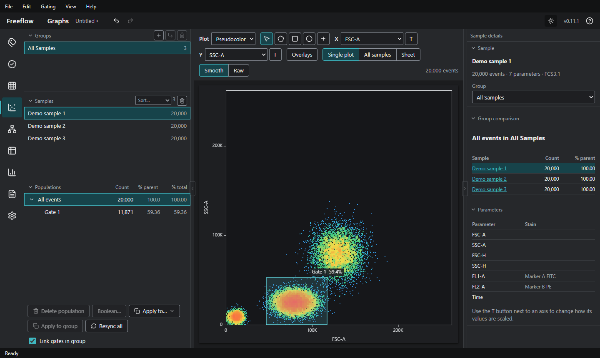

# Freeflow

Desktop app (Windows and Mac) for analysing flow cytometry data (`.fcs` files): plots (pseudocolor, contour, zebra, histogram), gating (polygon, rectangle, ellipse, range, quadrant, boolean), compensation, groups and subgroups, statistics tables, bar charts, reports, quality control, overlays and a cluster explorer (UMAP / t-SNE).

Everything runs on your computer: no account, no internet connection, no telemetry. The application code contains no network calls (see [SECURITY.md](SECURITY.md)).



## Download

Get the latest version from the [Releases](../../releases) page.

### Windows

- `Freeflow-Setup-X.Y.Z.exe`: installer (with uninstaller).
- `Freeflow-Portable-X.Y.Z.exe`: one file, nothing to install.
- `Freeflow-X.Y.Z-win-x64.zip`: extract anywhere and run `Freeflow.exe`.

The program is not code-signed, so Windows may show a warning. If Windows blocks the installer or the portable file, use the `.zip`, which runs without trouble. Details are in the [user guide](USER-GUIDE.md#windows).

### Mac

1. Download the `.dmg` for your chip (Apple menu > *About This Mac*): `…-mac-arm64.dmg` for Apple silicon (M1 or newer), `…-mac-x64.dmg` for Intel.
2. Open it and drag **Freeflow** to *Applications*.
3. macOS will say it "could not verify that Freeflow is free of malware". This happens because the program is not signed with a paid Apple developer account (Freeflow is open source, so you can read its code). Open it once in **one** of these two ways:
   - **Terminal (simplest, works on every macOS version).** Paste this line, press Return, then open Freeflow normally:

     ```
     xattr -cr /Applications/Freeflow.app
     ```

   - **System Settings.** Try to open Freeflow and click **Done**. Then open *System Settings > Privacy & Security*, scroll down to *Security*, click **Open Anyway** next to "Freeflow was blocked", enter your password (or Touch ID) and click **Open**. On macOS 14 and older you can instead right-click Freeflow > **Open** > **Open**.

   You only need to do this the first time.

**Portable (no installation):** download the `.zip` instead of the `.dmg`, unzip it and run `Freeflow.app` from anywhere (the Desktop, a USB drive). It needs the same one-time step above. On a Mac every app is already portable: to remove it, just delete `Freeflow.app`.

On a Mac, shortcuts use ⌘ and ⌥ instead of Ctrl and Alt, and ⌫ deletes. To uninstall, drag Freeflow from *Applications* to the Trash.

The Mac build is made, and its interface tests are run, by GitHub Actions on every push (203 browser tests pass on a Mac machine). It is new on Mac, so please report anything odd in the [Issues](../../issues).

## Documentation

- [User guide](USER-GUIDE.md): install, plots, gates, groups, statistics, shortcuts.
- [Security and privacy](SECURITY.md)
- [License](LICENSE) (MIT) and [third-party notices](THIRD-PARTY-NOTICES.md)

## Build from source

Requires [Node.js](https://nodejs.org) 24.

```
npm ci
npm run dev            # run the app in development mode
npm run typecheck      # type check
npm test               # unit tests
npx playwright install chromium && npx playwright test   # UI tests in a browser
npm run test:desktop   # start the real app and drive it

npm run dist           # Windows: installer, portable and .zip in release/
npm run dist:mac       # Mac (only on a Mac): .dmg and .zip, arm64 and x64
```

A Mac build can only be made on a Mac. Without one, the GitHub Actions workflow *Build Freeflow* builds both the Mac and the Windows programs on GitHub's machines (*Actions > Build Freeflow > Run workflow*; the results are under *Artifacts*). Pushing a tag such as `v0.12.0` also attaches both to a GitHub release.

## Project layout

```
src/core        analysis logic (FCS reader, scales, gates, statistics, clustering...), no UI
src/main        Electron main process (window, files, dialogs)
src/preload     the bridge between the window and the system
src/renderer    the interface (React)
tests, e2e, e2e-desktop   unit tests, browser UI tests, tests of the packaged app
```

## License

[MIT](LICENSE)
